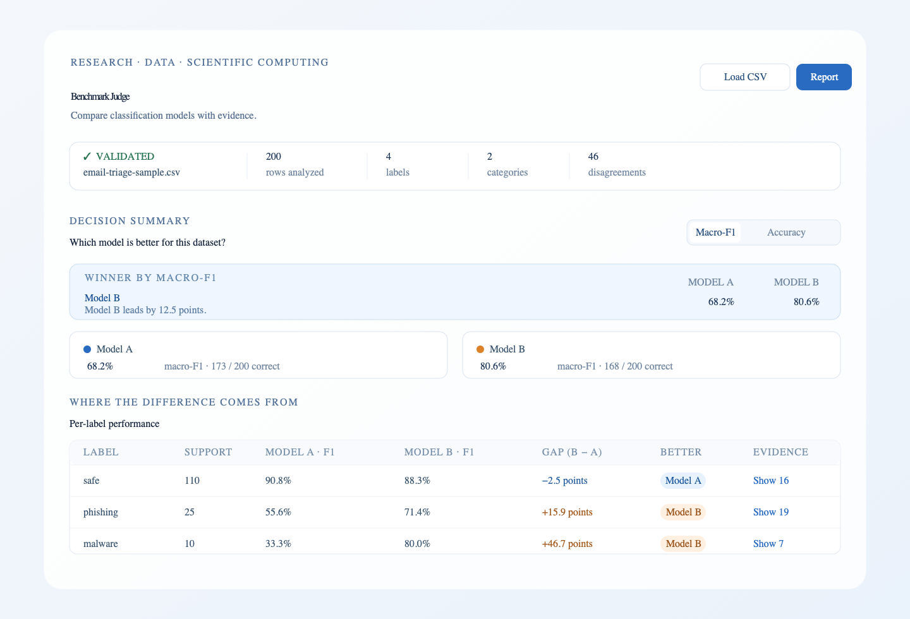

# Benchmark Judge

**Compare classification models beyond one accuracy number.** Benchmark Judge is a local-first browser app for uploading the same labeled evaluation examples and predictions from two models, then inspecting the per-label tradeoffs and the exact rows behind their disagreements.

Built for the **Research, Data & Scientific Computing** track of the OmniRush Frontier Buildathon.

| Resource | Link |
|---|---|
| Live demo | [benchmark-judge.vercel.app](https://benchmark-judge.vercel.app) |
| Source repository | [github.com/gunasaimahesh/benchmark-judge](https://github.com/gunasaimahesh/benchmark-judge) |
| Demo video | [2:20 narrated product walkthrough (MP4)](docs/benchmark-judge-demo.mp4) · [WebM](docs/benchmark-judge-demo.webm) |



The live demo is a public static Vercel deployment. It is built with Vite, served from `dist`, and connected to GitHub so pushes to `main` redeploy automatically.

## What it does

Benchmark Judge helps answer:

- Which model wins on accuracy, macro-F1, or balanced accuracy?
- Does the winner change when rare labels matter more?
- Which labels explain the difference, with support and true-positive counts?
- Is the paired accuracy difference distinguishable from chance on this evaluation set?
- Which exact examples did the models disagree on?

The dashboard includes metric comparisons, per-label performance, filter-aware disagreement counts, row-level evidence, shared-axis confusion matrices, optional category slices, and machine-readable exports.

All analysis runs in the browser. Uploaded files are not sent to an API or stored on a server.

## Quick start

### Use the live demo

Open [benchmark-judge.vercel.app](https://benchmark-judge.vercel.app) and click **Try sample dataset**.

### Run locally

```bash
npm ci
npm run dev
```

Open the local URL printed by Vite and click **Try sample dataset**. The bundled synthetic email-triage dataset demonstrates the main story:

- Model A has higher accuracy: **86.5% vs 84.0%**.
- Model B has higher macro-F1: **80.6% vs 68.2%**.
- Model B has higher balanced accuracy: **82.3% vs 63.6%**.
- The models disagree on 46 examples.
- Model A catches 2 of 10 malware examples; Model B catches 8 of 10.

The sample is synthetic and illustrative. It is not a claim about real email-security performance.

## Main workflow

1. Load the bundled sample or upload a prediction CSV.
2. Review the overview cards and switch the primary comparison metric. The secondary correct-count line is explicitly labeled **Accuracy** so it is not confused with macro-F1 or balanced accuracy.
3. Inspect per-label precision, recall, F1, support, and true-positive counts.
4. Filter disagreements by outcome, true label, category, or search term. Outcome chips recalculate within the active filters, and label options follow the dataset's support order.
5. Open a row to see the true label, both predictions, outcome, input text, and extra columns.
6. Compare the shared-axis confusion matrices and optional category slices.
7. Download the JSON report or disagreement CSV.

## CSV format

Download the [working CSV template](public/template.csv) or prepare a CSV with these required columns:

```csv
id,category,true_label,model_a,model_b,text
row-001,work,safe,safe,safe,Agenda for Monday's planning meeting
row-002,work,phishing,safe,phishing,Verify your password to avoid account suspension
```

| Column | Required | Description |
|---|---:|---|
| `id` | Yes | Unique example identifier. |
| `true_label` | Yes | Ground-truth class. |
| `model_a` | Yes | Model A prediction. |
| `model_b` | Yes | Model B prediction. |
| `category` | No | A real slice dimension such as source, language, or mailbox. |
| `text` | No | Input content shown in the disagreement detail view. |

Labels are case-sensitive. Blank required values, blank categories when the column exists, duplicate IDs, malformed rows, files over 10 MB, and files over 100,000 data rows are rejected with row-aware messages. Extra named columns are preserved in the row detail.

The repository also includes a deliberately invalid [validation fixture](public/broken-template.csv) for checking the missing-column, duplicate-ID, and blank-value error paths.

## Metrics

- **Accuracy:** correct predictions divided by all rows.
- **Per-label precision, recall, and F1:** calculated over the whole dataset.
- **Macro-F1:** mean F1 across ground-truth labels. Prediction-only labels are shown but excluded from the average.
- **Balanced accuracy:** mean recall across ground-truth labels.
- **McNemar exact test:** a paired exact test for the accuracy difference only. Its p-value describes this evaluation set; it does not guarantee future performance.

When a dataset has only one ground-truth label, the app allows analysis but warns that macro-F1 and balanced accuracy are less informative. The methodology panel explains the formulas, rounding, slice behavior, and limitations.

## Development

Node 22 is the reference runtime. The version is pinned in `.nvmrc`.

```bash
npm ci
npm test
npm run build
```

Start the development server separately when you want to use the app locally:

```bash
npm run dev
```

Generate the deterministic sample fixture again with:

```bash
npm run generate:sample
```

The sample story test checks the committed fixture's counts, metrics, disagreements, confusion-matrix rows, and McNemar value.

The current automated suite has **35 tests across 9 files**, covering CSV parsing and validation, metrics, comparisons, statistics, exports, the deterministic sample story, and disagreement-explorer filtering.

For a short manual check, use the browser UI to upload `public/template.csv`, then upload `public/broken-template.csv` and confirm the error panel reports the missing `model_b`, duplicate ID, and blank label. Load the sample dataset, switch metrics, inspect a malware disagreement, toggle the confusion matrix, and download both `benchmark-report.json` and `benchmark-disagreements.csv`.

The production smoke check has been run against the live URL. It passed the sample story, metric switch, clearly labeled accuracy counts, support-ordered label filter, filter-aware malware outcome counts (**All 7; A correct / B wrong 0; B correct / A wrong 6; Both wrong 1**), row detail dialog, confusion-matrix toggle, both downloads, valid template upload, malformed-upload errors, single-label warning, and refresh-to-empty behavior.

## Docker and offline verification

```bash
docker build -t benchmark-judge .
docker run --rm --network none benchmark-judge npm test
docker run --rm -p 4173:4173 benchmark-judge
```

Then open <http://localhost:4173>. The runtime app has no network dependency; the `--network none` command is the offline test proof.

## Project structure

```text
src/lib/                 CSV, validation, metrics, statistics, exports
src/components/          Dashboard sections and evidence explorer
src/fixtures/            Deterministic sample dataset
scripts/                 Sample data generator
tests/                   Data-layer, story, and explorer tests
docs/                    Dashboard preview and demo video
benchmark-judge-plan.md  Original project plan
benchmark-judge-plan-v2.md  Refined implementation plan
```

## Limitations and non-goals

The MVP supports exactly two models and single-label classification. It does not train models, run live inference, support regression or multi-label classification, connect to an AI API, or upload data to a backend. Results describe the supplied evaluation set only. Category slices can be noisy with small support, and McNemar's test covers the accuracy difference only.

## Buildathon note

This project was built in OmniRush for the Research, Data & Scientific Computing track.

### OmniRush session trail

The repository began as one large first commit, so these sessions document the build progression:

| Session | Role in the project |
|---|---|
| `ses_eaa83d2f3ffed7eZTQLmalSK4T` — **Omnirush Buildathon Project Comparison** | Compared the three project ideas, wrote and refined the v1/v2 plans, implemented the dashboard, prepared the repository, and handled deployment/readiness work. |
| `ses_eaa47decaffe5HbK71VAhBHYDg` — **Implement core benchmark engine (@general subagent)** | Implemented the CSV parser and validation, metric engine, McNemar test, deterministic sample generator, exports, and 32 data-layer tests. |

The later evidence-interaction polish added filter-aware disagreement counts, support-ordered label options, the single-label metric caveat, and explicit accuracy labels on the metric cards. The repository and live demo are ready for submission.
